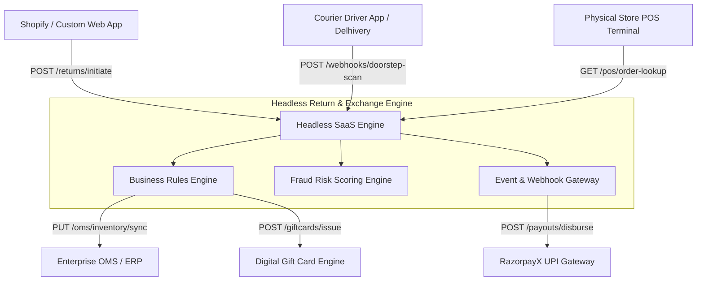

# Document 04 — System Architecture, API Data Mapping, Data Dictionary & RTM  
**Author:** Vishnu Rameshan   
**Status:** Approved Technical Architecture & Integration Spec

---

## 1. System Integration Architecture & API Endpoint Taxonomy

The Return & Exchange SaaS Engine operates as a headless middleware orchestration layer. It exposes REST APIs and ingests carrier webhooks to coordinate state changes across E-Commerce Storefronts, Order Management Systems (OMS), Payment Gateways, and Point-of-Sale (POS) retail terminals.



### Core API Endpoint Catalog

| Endpoint Identifier | HTTP Method | Target Endpoint URL Path | Invoking Actor / System | System Action Description |
| :--- | :--- | :--- | :--- | :--- |
| **API-PORT-01** | `POST` | `/api/v1/auth/otp/send` | Customer Portal UI | Triggers 6-digit SMS OTP for shopper authentication. |
| **API-PORT-02** | `GET` | `/api/v1/orders/{order_id}` | Customer Portal UI | Retrieves order item details, delivery date, and eligibility flags. |
| **API-PORT-03** | `POST` | `/api/v1/returns/initiate` | Customer Portal UI | Submits item selection, reason code, photo URLs, and chosen resolution. |
| **API-CAR-01** | `POST` | `/api/v1/webhooks/carrier/doorstep-scan` | Courier System (Delhivery) | Ingests real-time GPS barcode scan event from courier mobile app. |
| **API-PAY-01** | `POST` | `/api/v1/payouts/razorpayx/disburse` | SaaS Backend Engine | Triggers automated UPI disbursement call to RazorpayX API. |
| **API-POS-01** | `GET` | `/api/v1/pos/order-lookup` | Retail Store POS | Fetches online order validation data using scanned barcode at store counter. |

---

## 2. API Data Contracts & Payload Specifications

### 2.1 Doorstep Pickup Barcode Webhook Data Contract
* **Source System:** Carrier Logistics System (Delhivery API)  
* **Destination Endpoint:** SaaS Engine Gateway (`POST /api/v1/webhooks/carrier/doorstep-scan`)  
* **Security Layer:** Request header contains `X-Carrier-Signature` (HMAC SHA-256) for authentication.

#### Inbound Webhook JSON Request Payload:
```json
{
  "event_type": "DOORSTEP_PICKUP_SUCCESS",
  "event_id": "evt_9981240192",
  "timestamp": "2026-10-14T14:32:05Z",
  "carrier_code": "DELHIVERY_IN",
  "waybill_number": "WAYB-88392019",
  "data": {
    "return_request_id": "RET-2026-8812",
    "order_id": "ORD-99214",
    "agent_id": "AGT-4402",
    "pickup_location": {
      "latitude": 19.1860,
      "longitude": 73.1926,
      "pincode": "421501"
    },
    "scanned_barcode": "SKU-DENIM-BLU-L",
    "qc_status": "PASSED_SURFACE_INSPECTION"
  }
}
```

#### Outbound Webhook JSON Response Payload (`200 OK`):
```json
{
  "status": "SUCCESS",
  "code": 200,
  "message": "Webhook processed successfully.",
  "data": {
    "return_request_id": "RET-2026-8812",
    "payout_triggered": true,
    "payout_reference": "POUT-RAZOR-77312",
    "processed_at": "2026-10-14T14:32:06Z"
  }
}
```

---

### 2.2 RazorpayX UPI Instant Payout Data Contract
* **Source System:** SaaS Backend Engine  
* **Destination Endpoint:** Payment Gateway (`POST /api/v1/payouts/razorpayx/disburse`)

#### Outbound Request JSON Payload:
```json
{
  "account_number": "78129012384910",
  "amount": 185000,
  "currency": "INR",
  "mode": "UPI",
  "purpose": "refund",
  "fund_account": {
    "account_type": "vpa",
    "vpa": {
      "address": "vishnu@upi"
    },
    "contact": {
      "name": "Vishnu Rameshan",
      "email": "vishnu@example.com",
      "contact": "9876543210",
      "type": "customer"
    }
  },
  "queue_if_low_balance": true,
  "reference_id": "RET-2026-8812_PAYOUT",
  "narration": "Instant Return Refund for Order ORD-99214"
}
```

---

## 3. Core SaaS Data Dictionary

The data dictionary defines the database schema entities, attribute data types, nullability rules, and constraints powering the platform database.

### 3.1 Entity: `Return_Request`
Stores top-level transaction records for every initiated return or exchange request.

| Attribute Name | Data Type | Key Type | Nullable | Business Description & Validation Constraints |
| :--- | :--- | :--- | :--- | :--- |
| `return_id` | VARCHAR(36) | Primary Key | NO | System-generated UUID uniquely identifying the return request. |
| `order_id` | VARCHAR(32) | Foreign Key | NO | External reference ID linking to original e-commerce order. |
| `customer_id` | VARCHAR(32) | Foreign Key | NO | Unique customer record identifier. |
| `return_status` | ENUM | None | NO | Allowed values: `INITIATED`, `PICKUP_PENDING`, `IN_TRANSIT`, `COMPLETED`, `REJECTED`, `MANUAL_HOLD`. |
| `payout_method` | ENUM | None | NO | Allowed values: `UPI_INSTANT`, `STORE_CREDIT`, `EXCHANGE_SIZE`, `BANK_TRANSFER`. |
| `vpa_address` | VARCHAR(64) | None | YES | Encrypted UPI VPA address (AES-256 standard). Null if store credit selected. |
| `fraud_risk_score` | DECIMAL(3,2) | None | NO | Score calculated by rules engine (0.00 = safe, 1.00 = high risk). |
| `created_at` | TIMESTAMP | None | NO | UTC timestamp recorded when customer submits return request. |

### 3.2 Entity: `Return_Item`
Stores individual line-item details associated with a return request.

| Attribute Name | Data Type | Key Type | Nullable | Business Description & Validation Constraints |
| :--- | :--- | :--- | :--- | :--- |
| `item_id` | VARCHAR(36) | Primary Key | NO | System UUID for individual item record. |
| `return_id` | VARCHAR(36) | Foreign Key | NO | Foreign Key referencing `Return_Request.return_id`. |
| `sku` | VARCHAR(64) | None | NO | Stock Keeping Unit code of the physical product being returned. |
| `reason_code` | VARCHAR(32) | None | NO | Standardized taxonomy code (e.g., `SIZE_TOO_SMALL`, `DEFECTIVE_ITEM`). |
| `resolution_type` | ENUM | None | NO | Allowed values: `EXCHANGE_SAME_SKU`, `STORE_CREDIT_BONUS`, `CASH_REFUND`. |
| `refund_amount` | INT | None | NO | Calculated refund value stored in smallest currency unit (e.g., paise in INR). |

---

## 4. Requirements Traceability Matrix (RTM)

The Requirements Traceability Matrix guarantees bi-directional traceability connecting executive business goals through functional requirements, user stories, API contracts, and QA test cases.

| Business KPI Goal | BRD Scope ID | Functional Requirement (FRD) | Agile User Story ID | Target API Endpoint | Target QA Test Case ID |
| :--- | :--- | :--- | :--- | :--- | :--- |
| **KPI-01:** Reduce Refund TAT to < 60 Sec | `BRD-SCP-01` | `FR-PAY-002` (Doorstep Webhook Payout) | `US-PAY-01` | `API-CAR-01` / `API-PAY-01` | `TC-PAY-001` |
| **KPI-02:** Retain 35% Cash Margin | `BRD-SCP-02` | `FR-NDG-002` (Store Credit Bonus) | `US-NDG-01` | `API-PORT-03` | `TC-NDG-002` |
| **KPI-03:** Automate 80% Returns | `BRD-SCP-01` | `FR-PORT-001` (Portal Authentication) | `US-PORT-01` | `API-PORT-01` / `API-PORT-02` | `TC-PORT-001` |
| **KPI-04:** Enable O2O Store Sync | `BRD-SCP-04` | `FR-OMS-001` (POS Barcode Lookup) | `US-OMS-01` | `API-POS-01` | `TC-OMS-001` |
| **KPI-05:** Reduce Fraud Loss | `BRD-SCP-03` | `BRE-FRD-01` (Fraud Scoring Gate) | `US-FRD-01` | `API-CAR-01` | `TC-FRD-001` |
