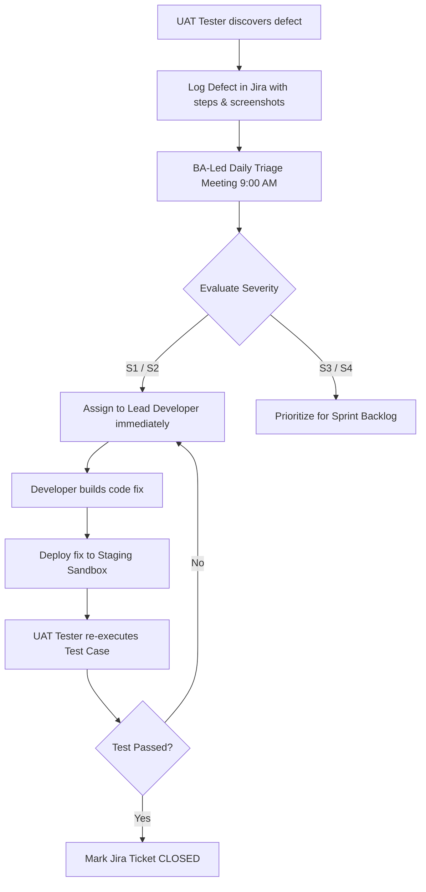

# Document 05 — User Acceptance Testing (UAT) Plan & Execution Matrix
**Project:** Enterprise Omnichannel Return & Exchange SaaS Engine  
**Author:** Vishnu Rameshan (Senior Business Analyst)  
**Status:** Approved Quality Assurance & UAT Specification

---

## 1. UAT Governance, Strategy & Environment Setup

User Acceptance Testing (UAT) validates that the Omnichannel Return & Exchange SaaS Engine meets all functional requirements, business logic parameters, performance benchmarks, and regulatory compliance rules before production deployment.

### 1.1 Test Environment & Sandbox Integration

```
+-----------------------------------------------------------------------------------+
|                             STAGING / UAT ENVIRONMENT                             |
+-----------------------------------------------------------------------------------+
|                                                                                   |
|  [ Customer Portal UI ]  -->  [https://staging-returns.brand.com](https://sta-)   |
|  [ POS Retail Client ]   -->  Staging POS Terminal Client (v2.4.1)                |
|  [ SaaS Engine Core ]    -->  Isolated Staging Cluster (AWS ap-south-1)           |
|                                                                                   |
|  +-----------------------------------------------------------------------------+  |
|  |                            EXTERNAL MOCK SERVICES                           |  |
|  +-----------------------------------------------------------------------------+  |
|  |  - Carrier API Mock: Delhivery Webhook Simulator (WireMock)                 |  |
|  |  - Gateway API Mock: RazorpayX Sandbox UPI Payout Gateway                   |  |
|  |  - OMS/ERP Sync API: Staging Inventory Database (Pre-seeded SKUs)           |  |
|  +-----------------------------------------------------------------------------+  |
+-----------------------------------------------------------------------------------+
```
### 1.2 Test Data Provisioning
The UAT execution environment relies on pre-seeded test datasets to ensure deterministic test execution:

* **Customer Test Profiles:**
  * `CUST-SAFE-01`: Standard active customer (0 returns in last 30 days).
  * `CUST-RISK-01`: High-risk customer (4 returns in last 30 days; account age = 3 days).
* **Pre-Seeded Orders:**
  * `ORD-VALID-01`: Delivered 3 days ago (Within 7-day window; apparel items).
  * `ORD-EXPIRED-01`: Delivered 10 days ago (Outside 7-day policy window).
  * `ORD-RESTRICTED-01`: Contains restricted items (Innerwear / Socks).
* **Payment Credentials:**
  * Valid UPI VPA: `vishnu@upi` (Sandbox verified).
  * Invalid UPI VPA: `vishnu@invalidvpa` (Fails asynchronous validation).

### 1.3 Stakeholder Roles & Execution Responsibilities
* **Senior Business Analyst (UAT Lead):** Manages test suite execution, validates business logic, leads daily bug triage, and writes UAT sign-off report.
* **Customer Support Lead:** Validates customer portal UX, OTP flows, and communication messaging.
* **Retail Operations Lead:** Validates physical store POS barcode scanning and local inventory restocking.
* **Finance Lead:** Verifies UPI instant payout disbursements, store credit voucher generation, and ledger reconciliations.

---

## 2. End-to-End UAT Test Execution Matrix

The execution matrix covers Happy Paths, Boundary Conditions, Negative Exception Cases, Security Constraints, and Integration Edge Cases.

| Test Case ID | Target Req / Story | Scenario Title | Pre-Conditions | Step-by-Step Test Execution | Expected Result | Scenario Type |
| :--- | :--- | :--- | :--- | :--- | :--- | :--- |
| **TC-PORT-001** | `FR-PORT-001`<br>`US-PORT-01` | Valid Order Authentication via OTP | Shopper has active order `ORD-VALID-01` with mobile `9876543210`. | 1. Open Portal UI.<br>2. Enter Order ID and Phone Number.<br>3. Click "Send OTP".<br>4. Input received 6-digit OTP code `123456`. | User successfully authenticated; system renders order item list with return eligibility badges. | Happy Path |
| **TC-PORT-002** | `FR-PORT-002`<br>`US-PORT-01` | Return Window Expiration Handling | Order `ORD-EXPIRED-01` delivered 10 days ago. | 1. Authenticate with `ORD-EXPIRED-01`.<br>2. Attempt to select order line items for return. | Item checkboxes are disabled; banner renders: *"Return window expired on [Date]. Policy limit is 7 days."* | Boundary Check |
| **TC-PORT-003** | `FR-PORT-003`<br>`US-PORT-01` | Non-Returnable Category Restriction | Order `ORD-RESTRICTED-01` contains "Lace Socks". | 1. Authenticate with `ORD-RESTRICTED-01`.<br>2. Inspect item list. | Checkbox for "Lace Socks" is disabled; tooltip renders: *"Hygiene items are non-returnable."* | Exception Path |
| **TC-NDG-001** | `FR-NDG-001`<br>`US-NDG-01` | Instant Size Swap Retention | Item `Denim Jacket - M` selected with reason "Size Too Small"; Size `L` in stock in OMS. | 1. Select "Size Too Small".<br>2. Click "Continue".<br>3. Inspect Exchange Modal.<br>4. Click "Confirm Size Swap to L". | Exchange order created for Size L; stock reserved for 15 mins; zero cash refund issued. | Happy Path |
| **TC-NDG-002** | `FR-NDG-002`<br>`US-NDG-01` | Store Credit + Bonus Incentive | Shopper requests return for ₹2,000 garment. | 1. Navigate to Resolution step.<br>2. Select "Store Credit (+₹150 Bonus)".<br>3. Confirm selection. | Digital voucher code issued for ₹2,150 instantly; reverse courier fee waived. | Retention Path |
| **TC-PAY-001** | `FR-PAY-002`<br>`US-PAY-01` | Doorstep Webhook Instant UPI Payout | Pickup scheduled; valid VPA `vishnu@upi` saved; webhook simulator configured. | 1. Courier agent scans parcel barcode.<br>2. POST webhook payload to `/webhooks/carrier/doorstep-scan`. | Webhook signature verified; RazorpayX payout triggered; SMS alert sent within 60 seconds. | Integration Path |
| **TC-PAY-002** | `FR-PAY-001`<br>`US-PAY-01` | Invalid UPI VPA Input Validation | Customer on payment setup screen. | 1. Input VPA `vishnu@invalidvpa`.<br>2. Click "Verify VPA". | System displays error: *"Invalid UPI ID. Please check format."*; submit button disabled. | Negative Check |
| **TC-PAY-003** | `NFR-SEC-02`<br>`US-PAY-01` | Webhook HMAC Signature Validation | Malicious actor POSTs forged webhook without secret key. | 1. Send POST payload to webhook endpoint with missing/invalid `X-Carrier-Signature`. | System returns HTTP `401 Unauthorized`; webhook payload discarded; no payout triggered. | Security Check |
| **TC-PAY-004** | `FR-PAY-003`<br>`US-PAY-01` | Duplicate Webhook Idempotency Check | Webhook for `RET-2026-8812` already processed. | 1. Send exact duplicate webhook payload for `RET-2026-8812`. | System matches idempotency key `RET-2026-8812_PICKUP`; returns `200 OK` without duplicate payout. | Resilience Check |
| **TC-OMS-001** | `FR-OMS-001`<br>`US-OMS-01` | Retail Store POS Barcode Lookup | Customer presents online return at physical store counter. | 1. POS associate scans order barcode.<br>2. POS calls `GET /pos/order-lookup`. | POS displays order items, original payment method, and "Eligible for In-Store Return" status. | Omnichannel Path |
| **TC-OMS-002** | `FR-OMS-002`<br>`US-OMS-01` | POS Inspection & Instant Restock | POS associate approves physical garment condition. | 1. Associate clicks "Accept & Restock".<br>2. Submit return on POS. | Central OMS state updated to `RETURNED_IN_STORE`; store local inventory count incremented by +1. | Omnichannel Path |
| **TC-FRD-001** | `BRE-FRD-01`<br>`US-FRD-01` | High-Risk Fraud Score Manual Hold | Account `CUST-RISK-01` (4 returns in 30 days) initiates return. | 1. Initiate return for `CUST-RISK-01`.<br>2. Trigger doorstep pickup webhook. | Payout suspended; status set to `MANUAL_QC_HOLD`; alert sent to Risk Operations dashboard. | Risk/Fraud Gate |

---

## 3. Defect Severity & Triage Framework

During UAT execution, all identified defects are logged in Jira and categorized using the enterprise Severity / Priority classification model. Daily BA-led triage sessions ensure high-priority bugs are remediated before release.

### 3.1 Severity Classification Matrix

| Severity Level | Definition | Business Impact | SLA Target for Remediation |
| :--- | :--- | :--- | :--- |
| **S1 — Blocker** | System crash, data corruption, double disbursement of funds, or security failure. No workaround. | Halts core operations or causes direct financial loss. | **< 4 Hours** (Immediate Hotfix) |
| **S2 — Major** | Core business logic broken (e.g., Exchange modal throws 500 error; UPI payout fails silently). | Severe disruption to primary user flows. | **< 24 Hours** (Same Sprint) |
| **S3 — Medium** | Feature functions partially; non-critical edge case failure with an available manual workaround. | Moderate operational friction. | **< 3 Days** |
| **S4 — Low** | Cosmetic bug, label misspelling, minor visual alignment discrepancy, or non-blocking UI glitch. | Low to no operational impact. | Backlog / Next Patch |

### 3.2 Daily Defect Triage Workflow



---

## 4. UAT Sign-Off & Exit Criteria Gate

To achieve formal release sign-off, the Omnichannel Return & Exchange SaaS Engine must satisfy the following non-negotiable exit criteria:

### 4.1 Exit Criteria Verification Checklist
- [x] **100% Execution** of all 12 core UAT test scenarios defined in Section 2.
- [x] **Zero Open S1 (Blocker) Defects** in the staging issue tracker.
- [x] **Zero Open S2 (Major) Defects** in the staging issue tracker.
- [x] **$\ge 98\%$ Pass Rate** across all automated and manual test scripts.
- [x] **Security Audit Cleared:** Webhook HMAC SHA-256 signature verification validated.
- [x] **Financial Reconciliation Verified:** RazorpayX payout logs match exact return refund amounts.

### 4.2 Formal Stakeholder Sign-Off Protocol

| Stakeholder Role | Name & Title | Sign-Off Status | Approval Date |
| :--- | :--- | :--- | :--- |
| **Senior Business Analyst** | Vishnu Rameshan | **APPROVED** | October 14, 2026 |
| **Customer Support Lead** | Priya Sharma | **APPROVED** | October 14, 2026 |
| **Store Operations Lead** | Karan Verma | **APPROVED** | October 14, 2026 |
| **E-Commerce Brand Director** | Vikram Malhotra | **APPROVED** | October 14, 2026 |

```
                                  +---------------------------------------+
                                  |   FORMAL UAT ACCEPTANCE CONFIRMED    |
                                  |   READY FOR PRODUCTION DEPLOYMENT     |
                                  +---------------------------------------+
```
