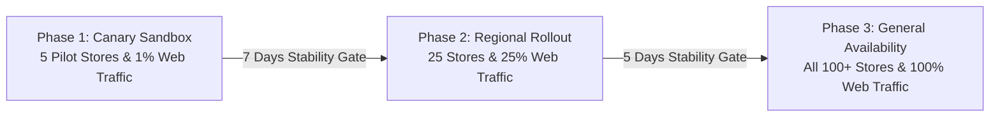
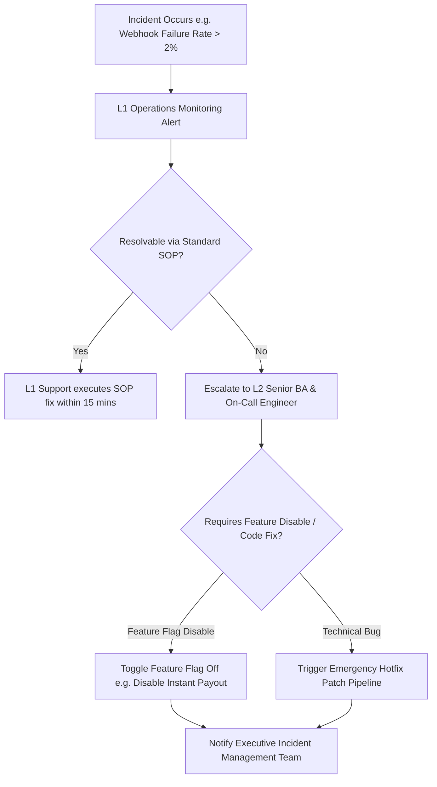

# Document 06 — Change Management Plan, Release Engineering & Risk Matrix
**Project:** Enterprise Omnichannel Return & Exchange SaaS Engine  
**Author:** Vishnu Rameshan (Senior Business Analyst)  
**Status:** Approved Operational & Release Engineering Baseline

---

## 1. Organizational Change Management (OCM) Strategy

Deploying an enterprise SaaS returns engine disrupts established retail store workflows, customer support habits, and warehouse processing routines. To ensure seamless adoption across all user groups, this plan utilizes Prosci's ADKAR framework (Awareness, Desire, Knowledge, Ability, Reinforcement).

### 1.1 ADKAR Change Enablement Matrix

| ADKAR Stage | Change Goal | Enablement Strategy | Target Stakeholders | Success Metric |
| :--- | :--- | :--- | :--- | :--- |
| **Awareness** | Communicate why legacy manual returns fail (7-10 day TAT, 90% revenue leakage). | Executive townhalls, video teasers, ROI impact infographics. | All Retail & CS Staff | 100% awareness survey completion. |
| **Desire** | Address "What's in it for me?" (Reduced customer complaints, faster store restocking). | Incentive program: Store bonuses for exchange conversion; performance awards. | Store Associates & CS Reps | > 85% positive sentiment score. |
| **Knowledge** | Train staff on new POS barcode lookup, portal navigation, and exception handling. | Interactive LMS modules, role-specific SOP cheat sheets, hands-on sandbox practice. | Store Associates, CS, Warehouse | 100% pass rate on certification quiz. |
| **Ability** | Hands-on execution during 2-week pilot run with live support. | Floor champions, dedicated Slack/Teams war room, real-time shadow support. | Store Associates & CS Reps | < 30 sec POS return handling time. |
| **Reinforcement** | Sustain adoption and prevent fallback to manual paper workflows. | Weekly SLA audits, automated adoption dashboards, executive leaderboards. | Regional Store Managers | < 1% manual override requests. |

---

### 1.2 Persona-Based Training Program

| Role / Persona | Training Focus | Delivery Method | Duration | Certification Gate |
| :--- | :--- | :--- | :--- | :--- |
| **Retail Store Associates** | In-store barcode scanning, item inspection guidelines, POS restock updates, exchange processing. | In-person store workshops & hands-on POS sandbox practice. | 2 Hours | Practical test: Process 3 mock store returns in < 60 seconds each. |
| **Customer Support Reps** | Portal OTP authentication assistance, manually triggering re-scans, handling fraud holds. | E-learning modules & simulated customer ticket handling. | 3 Hours | Quiz score >= 90% on exception handling scenarios. |
| **Warehouse QC Team** | Scanning returned parcels, inspecting garment conditions, updating ERP inventory tags. | On-site warehouse floor training & scanner calibration exercises. | 2 Hours | Process 20 test packages with 0 tagging errors. |
| **Finance Operations** | Daily RazorpayX payout ledger reconciliation, store credit voucher audits, fraud flags. | Interactive webinar & financial dashboard walkthrough. | 1.5 Hours | Successful trial month-end ledger reconciliation. |

---

### 1.3 Standard Operating Procedure (SOP): In-Store Retail Return Processing

1. **Customer Greeting & Barcode Retrieval:**
   - Store Associate greets customer at counter.
   - Asks customer for order barcode (from mobile receipt) or phone number.
   - Scans barcode on POS screen (`GET /api/v1/pos/order-lookup`).
2. **Item Condition Verification:**
   - Associate inspects physical garment against return guidelines:
     - Check 1: Original tags intact and attached.
     - Check 2: No stains, odor, or signs of wear.
     - Check 3: Verified as a returnable category (non-innerwear).
3. **POS Resolution & Inventory Sync:**
   - If **Passed:** Select "Accept & Restock", choose local store bin location, click "Confirm Return". System auto-updates central OMS inventory (`PUT /oms/inventory/sync`) and issues store credit / instant refund.
   - If **Failed:** Select "Reject Return", choose reason code (e.g., `TAGS_MISSING`), hand garment back to customer, and hand out policy flyer.

---

## 2. Release Engineering & Deployment Strategy

To eliminate operational risk during deployment, the platform utilizes a **Phased Canary Deployment Strategy** controlled by dynamic Feature Flags.

### 2.1 Canary Deployment Phases



| Deployment Phase | Traffic Allocation | Store Coverage | Duration | Gate Exit Criteria |
| :--- | :--- | :--- | :--- | :--- |
| **Phase 1: Canary Pilot** | 1% Online Web Traffic | 5 Select Flagship Stores (Mumbai/Delhi) | 7 Days | 0 Critical (S1) Bugs, API Latency < 200ms, Error Rate < 0.1%. |
| **Phase 2: Regional Expansion** | 25% Online Web Traffic | 25 Stores (Tier-1 Metro Cities) | 5 Days | Exchange Nudge conversion >= 30%, zero payout reconciliation drift. |
| **Phase 3: Full Release (GA)** | 100% Online Web Traffic | All 100+ Retail Stores Nationwide | Ongoing | Full SLA adherence, support ticket volume reduction verified. |

---

### 2.2 Feature Flag Governance Framework

Key platform features are controlled via **LaunchDarkly / Custom Feature Flag Toggles**, allowing instant kill-switch capabilities without code redeployments.

| Feature Flag Key | Feature Description | Default State | Rollback Action on Failure |
| :--- | :--- | :--- | :--- |
| `FF_INSTANT_UPI_PAYOUT` | Triggers RazorpayX instant refund on carrier doorstep webhook scan. | `ENABLED` | Toggling `DISABLED` reverts refund processing to standard warehouse post-QC batch processing. |
| `FF_EXCHANGE_NUDGE_MODAL` | Renders 1-click size swap modal and +₹150 store credit bonus offer. | `ENABLED` | Toggling `DISABLED` skips retention nudge and routes user directly to standard return option. |
| `FF_POS_O2O_LOOKUP` | Enables retail POS terminals to scan and process online order returns. | `ENABLED` | Toggling `DISABLED` restricts POS to store-purchased returns only. |
| `FF_FRAUD_RISK_GATE` | Automated suspension of payouts for customer risk scores > 0.70. | `ENABLED` | Toggling `DISABLED` sends all flagged returns to manual CS queue. |

---

### 2.3 Automated Rollback Triggers & Cutover Checklist

```
+-----------------------------------------------------------------------------------+
|                           AUTOMATED ROLLBACK TRIGGERS                             |
+-----------------------------------------------------------------------------------+
|  1. API Error Rate (HTTP 5xx) exceeds 1.0% over a 5-minute rolling window.         |
|  2. API Response Latency (p99) exceeds 500ms for consecutive 3 minutes.           |
|  3. RazorpayX Payout API returns > 2% failed disbursement webhooks within 1 hour. |
|  4. Ingestion queue backlog for carrier webhooks exceeds 5,000 unprocessed events.|
+-----------------------------------------------------------------------------------+
```

#### Pre-Deployment Cutover Checklist:
- [x] Database migration scripts executed and verified in staging sandbox.
- [x] External API credentials (RazorpayX production keys, Delhivery webhooks) loaded into Vault.
- [x] Feature flags configured and verified in production control panel.
- [x] Rollback plan tested in staging with a simulated database rollback trigger.
- [x] Customer Support and Store Operations War Room active on MS Teams/Slack.

---

## 3. Risk Assessment & Mitigation Matrix

### 3.1 Quantitative Risk Scoring Model

$$\text{Risk Score} = \text{Probability (1–5)} \times \text{Impact (1–5)}$$

* **Probability:** $1 = \text{Rare}$, $2 = \text{Unlikely}$, $3 = \text{Possible}$, $4 = \text{Likely}$, $5 = \text{Almost Certain}$
* **Impact:** $1 = \text{Insignificant}$, $2 = \text{Minor}$, $3 = \text{Moderate}$, $4 = \text{Major}$, $5 = \text{Catastrophic}$
* **Risk Score Rating:** $1\text{--}6 = \text{Low}$, $8\text{--}12 = \text{Medium}$, $15\text{--}25 = \text{High / Critical}$

---

### 3.2 Enterprise Risk Matrix

| Risk ID | Risk Category | Risk Event Description | Prob (P) | Imp (I) | Risk Score | Mitigation Strategy | Contingency Plan |
| :--- | :--- | :--- | :--- | :--- | :--- | :--- | :--- |
| **RSK-TECH-01** | Technical Integration | Carrier (Delhivery) API outages cause dropped doorstep scan webhooks. | 3 | 4 | **12 (Med)** | Implement asynchronous queue (RabbitMQ/SQS) with 5-exponential retry policy. | Courier driver app triggers SMS fallback link to trigger manual scan receipt. |
| **RSK-FIN-01** | Financial / Fraud | Sophisticated return fraud (empty box / wrong item scanned at doorstep). | 3 | 5 | **15 (High)** | Fraud Risk Engine (`BRE-FRD-01`) flags accounts with >2 returns in 30 days for post-warehouse QC payout. | Freeze customer account and initiate courier agent field audit. |
| **RSK-OPS-01** | Operational | Retail store staff resist using POS return tool due to rush hour queues. | 4 | 3 | **12 (Med)** | Gamified incentives (+₹20 per processed exchange); dedicated return express counter. | Fallback to mobile tablet app for queue-busting returns. |
| **RSK-PAY-01** | Payment Integration | RazorpayX bank node downtime prevents instant UPI disbursement. | 2 | 4 | **8 (Med)** | Automatic fallback to secondary payment gateway or batch NEFT processing. | Send customer SMS notification: *"Payout delayed by bank node; processing within 6 hrs."* |
| **RSK-SEC-01** | Security / Legal | Man-in-the-Middle (MitM) attack forging fake webhook calls to trigger unauthorized refunds. | 2 | 5 | **10 (Med)** | Strict HMAC SHA-256 signature verification on all inbound webhook headers; IP whitelisting. | Instantly revoke carrier API keys and halt automated payouts via Feature Flag kill-switch. |
| **RSK-OMS-01** | Data Sync | Network drop at physical store causes POS local inventory to desynchronize with central OMS. | 3 | 3 | **9 (Med)** | Local offline storage in POS memory with automatic auto-sync retry upon network reconnect. | Daily automated 11:00 PM inventory reconciliation job between store POS and ERP. |

---

## 4. Operational Risk Escalation Pathway


