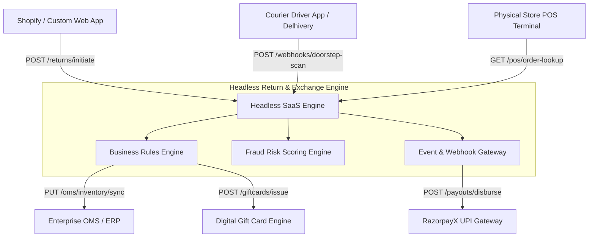

# Omnichannel Return & Exchange SaaS Engine — Enterprise Business Analysis Portfolio

**Author:** Vishnu Rameshan (Senior Business Analyst)  
**Target Role:** Senior Business Analyst — Accenture Song  
**Domain:** Headless E-Commerce SaaS, Reverse Logistics, FinTech (UPI Payouts), O2O Retail Systems  

---

## Executive Overview & Business Case

Fast-fashion D2C retail brands across India experience return rates between 25% and 40% on Cash-on-Delivery (COD) orders. Legacy return operations rely on manual customer support ticketing, resulting in high operational overhead (₹45–₹60 per ticket), a 7-to-10 day cash refund turnaround time (TAT), and a near 100% loss of returned merchandise value.

The **Omnichannel Return & Exchange SaaS Engine** is an enterprise-grade headless middleware designed to solve reverse logistics friction. By automating return eligibility checks, embedding revenue-retaining "Exchange Nudges," executing instant doorstep UPI payouts via webhooks, and synchronizing online returns with physical retail Point-of-Sale (POS) inventory, the system preserves gross margins while driving post-purchase customer satisfaction.

```
+-----------------------------------------------------------------------------------+
|                            CORE SYSTEM VALUE PROPOSITION                          |
+-----------------------------------------------------------------------------------+
|  [ Legacy As-Is ]   --> 7-10 Days Refund TAT | 90%+ Cash Leakage | ₹50/Ticket Cost  |
|  [ SaaS Engine ]    --> < 60 Sec UPI Refund  | 35%+ Retention    | < ₹5/Ticket Cost |
+-----------------------------------------------------------------------------------+
```

---

## 📁 Repository Structure & Documentation Roadmap

```
omnichannel-returns-ba-portfolio/
├── 01_Requirements_Documentation/
│   ├── 01_Executive_Summary_and_Scope.md             # BRD Scope, Strategy & Primary KPIs
│   ├── 02_Functional_and_Non_Functional_Requirements.md # FRD, BRE Logic & NFR Specifications
│   ├── 03_Agile_User_Stories_and_Backlog.md          # Agile Backlog, Gherkin BDD & DoD
│   └── 04_API_Data_Mapping_and_RTM.md                # API Contracts, Data Dictionary & RTM
├── 02_Process_Flows/
│   ├── 01_As_Is_Manual_Return_Flow.md                # Legacy Process Breakdown & Bottlenecks
│   └── 02_To_Be_Automated_SaaS_Flow.md               # Future-State Event-Driven Workflow
├── 03_UAT_and_Quality_Assurance/
│   └── 01_UAT_Test_Plan_and_Execution_Matrix.md     # UAT Strategy, Test Matrix & Defect Triage
├── 04_Release_and_Change_Management/
│   └── 01_Change_Management_Plan_and_Risk_Matrix.md # ADKAR Plan, Canary Rollout & Risk Matrix
└── README.md                                         # Executive Summary & Interview Guide
```

---

## System Architecture & Integration Topology

The platform operates as a headless middleware orchestration layer built on API-first principles. It acts as the central brain between customer-facing storefronts, logistics carriers, payment processors, and physical retail stores.



---

## Primary Business Metrics & Key Performance Indicators (KPIs)

| Business Goal / Metric | Legacy Baseline ("As-Is") | Target Threshold ("To-Be") | Strategic Impact |
| :--- | :--- | :--- | :--- |
| **Refund Turnaround Time (TAT)** | 7–10 Business Days | < 60 Seconds (Post-Doorstep Scan) | Drastic reduction in "Where is my refund?" support tickets. |
| **Revenue Retention Rate** | < 10% (90%+ Cash Leakage) | >= 35% Retained via Swaps/Credit | Preserves gross merchandise value (GMV) and cash liquidity. |
| **Support Cost per Return** | ₹45 – ₹60 per manual ticket | < ₹5 per automated request | 85%+ reduction in operational customer service overhead. |
| **Omnichannel (O2O) Processing** | 0% (In-store returns blocked) | 100% Real-Time POS Sync | Drives foot traffic to physical retail outlets. |
| **Fraud Loss Rate** | ~ 4.2% of total returns | < 0.5% through Fraud Scoring | Prevents empty box and counterfeit return fraud. |

---


* **Specializations:** Requirement Engineering, BPMN 2.0 Process Modeling, API Data Contracts, Agile/Scrum Delivery, UAT Governance, Financial & Logistics Integrations.  
* **Portfolio Repository:** `omnichannel-returns-ba-portfolio`
